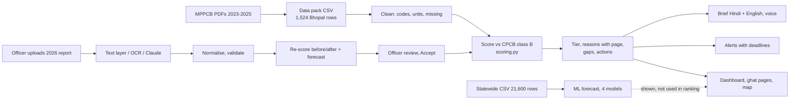
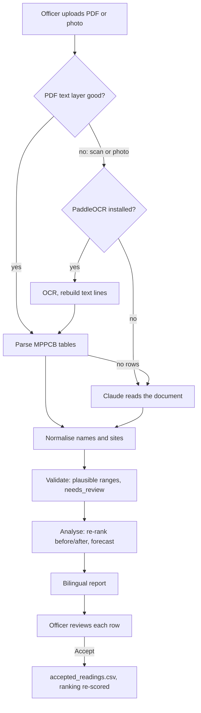

# 3. How the pipeline works

This is the full path from the PDF reports to the officer's screen. Code lives in `backend/ghatwatch/`. Exact rules are in [METHOD.md](../METHOD.md), [METHOD-INTAKE.md](../METHOD-INTAKE.md) and [METHOD-AI.md](../METHOD-AI.md).



## (a) Data pack and cleaning

Source: `track-2-visarjan-ghat-watch/data/bhopal_ghats_2023_2025.csv` (1,524 rows: 7 ghats × 2023–2025 × Ganesh and Durga × pre/during/after × 13 parameters). Each row keeps `source_page`, the page in that year's PDF. Loading is in `backend/ghatwatch/data.py`.

| As printed in the report | Flag | How Ghat Watch treats it |
|---|---|---|
| a number | – | a numeric reading |
| `BDL` / `ND` | BDL / ND | Shown as "BDL". Very low, but **not 0**. Never scored (all BDL rows are metals, which have no class B limit). |
| blank, `_`, `-` | not sampled | Missing. Shown as "not sampled". Listed as a gap. **Never clean, never 0.** |
| `*`, `**` | `*` / `**` | The whole phase was not sampled. Listed as a phase gap. |
| no table in the report | – | Whole festival-year missing (Bairagarh and Malikhedi, Durga 2025). Forces "Not tested" (Insufficient data). |

Other cleaning: blank cells with no flag under a `*`/`**` column (Ganesh 2025 pre/after at Bairagarh and Malikhedi) get the flag `not sampled` on load. The garbled conductivity unit in the CSV is normalised to `µS/cm`. Units are the ones assumed in the pack, because the reports print none.

## (b) Scoring

Only three parameters have a CPCB class B limit: DO, BOD and pH. Only they are scored. All other parameters are shown as context.

### Step 1: how far each reading is past the limit (exceedance, 0 to 1)

| Parameter | Formula | Examples |
|---|---|---|
| DO (limit ≥ 5) | `clip((5 − v) / 5, 0, 1)` | 0 → 1.0; 2.5 → 0.5; 5 or more → 0 |
| BOD (limit ≤ 3) | `clip((v − 3) / 9, 0, 1)` | 3 → 0; 12 or more (4× the limit) → 1.0 |
| pH (6.5–8.5) | `clip(distance outside 6.5–8.5, 0, 1)` | 9.2 → 0.7 |

`clip(x, 0, 1)` means: below 0 becomes 0, above 1 becomes 1.

### Step 2: weights

| Weight | Values |
|---|---|
| Parameter | DO 0.45, BOD 0.40, pH 0.15 |
| Year | 2025 = 1.0, 2024 = 0.75, 2023 = 0.5 |
| Phase | during = 1.0, after = 1.0, pre = 0.5 |

`score = Σ(w_param · w_year · w_phase · exceedance) / Σ(w_param · w_year · w_phase)`, over the numeric DO/BOD/pH readings that exist. Missing readings are not counted as 0; they lower **coverage** instead.

- **coverage** = available DO + BOD + pH readings / 54 (3 parameters × 3 phases × 6 festival-years).
- **breach rate** = readings that break the limit / available readings.
- **trend** = breach rate in the latest year minus the earliest year: ≥ +0.15 worsening, ≤ −0.15 improving, else stable.

### Step 3: tier rules, applied in order (the rule that fired is shown on the card)

| Order | Rule | Tier (screen word) |
|---|---|---|
| 1 | coverage < 0.5, or no Durga 2025 table | Insufficient data (**Not tested**), action "Test first", always sorted to the top |
| 2 | any DO = 0 in 2024–2025, or DO < 3 in Durga 2025, or score ≥ 0.45 | High (**Danger**) |
| 3 | score ≥ 0.25 | Medium (**Watch**) |
| 3b | BOD above 3 in at least two-thirds of readings since 2024 (minimum 6 readings) **and** median BOD ≥ 6 mg/l | Medium (**Watch**), the "persistent-BOD floor" |
| 4 | otherwise | Low (**Lower risk**). The text always says how many recent BOD readings still breached. |

Sort order: Not tested, Danger, Watch, Lower risk; within a tier, higher score first.

### Step 4: actions

| Action | When |
|---|---|
| **Aerate** | DO share of the score ≥ 0.5, or any DO < 3 in 2024–25 |
| **Clean** | any BOD > 6 mg/l (twice the limit) in 2024–25, or a COD / turbidity / solids context flag |
| **Test first** | tier Insufficient data (pre-immersion sample by 17 Oct, all three phases) |
| **Sample metals** | any metal reading ≥ 1.5 mg/l in the history (`METAL_SPIKE_MG_L = 1.5` in `scoring.py`, a screening trigger; there is no CPCB bathing limit for metals) |
| **NGT lake ban** banner | Bairagarh and Prempura (Upper Lake), Khatlapura and Rani Kamlapati (Lower Lake) |

### Step 5: reasons with pages

Each ghat gets up to 3 breach reasons (the largest weighted contributions, at most 2 per parameter), up to 2 context flags and 1 gap line. Every reason carries year, festival, phase, parameter, value, unit, limit and the source page. A test checks that each cited reading exists on that page in the CSV. Example:

- EN: "Dissolved oxygen was 0 mg/l during Ganesh 2025. The bathing limit is at least 5 mg/l. Source: MPPCB 2025 report, page 28."
- HI: "गणेश 2025 के विसर्जन के दौरान घुलित ऑक्सीजन 0 mg/l थी। स्नान मानक कम से कम 5 mg/l है। स्रोत: MPPCB 2025 रिपोर्ट, पृष्ठ 28।"

### Worked example: Rani Kamlapati ghat / Kamla Park kund (rank 4)

From `ranking.json` and the README: DO 2.4–2.6 mg/l in all three Durga 2025 phases (2025 report p. 64); coverage 1.00; score 0.21.

1. Coverage is 1.00 and a Durga 2025 table exists, so rule 1 does not fire.
2. Take the reading **DO 2.4 mg/l, during Durga 2025**. Exceedance = (5 − 2.4) / 5 = **0.52**. Its weight = 0.45 (DO) × 1.0 (2025) × 1.0 (during) = 0.45. Contribution to the top sum = 0.45 × 0.52 = 0.234.
3. Rule 2: DO 2.4 is below 3 in Durga 2025, so the tier is **High (Danger)**, even though the overall score (0.21) is below 0.45. The card shows the rule: "DO 2.4 mg/l during Durga 2025".
4. Action **Aerate** (DO < 3 in 2024–25). The NGT Lower Lake banner also shows.

Compare Hathaikheda (rank 5): its DO always meets the limit, so its score stays at 0.20. But BOD was above 3 in 12 of 12 readings since 2024 with a median of 7 mg/l, so rule 3b lifts it to **Watch**. Its BOD 22, COD 177.8 and turbidity 193.5 NTU (Ganesh 2024 after, 2024 report p. 71) trigger the **Clean** action.

## (c) Upload: a new 2026 report



1. **Extract.** Text PDFs are read with `pypdf` (or `pdftotext -layout`). Scans and photos go to **PaddleOCR**, run in a separate environment (`backend/.ocr-venv`). Claude reads the document only as the fallback: when text and OCR give no rows, or OCR is needed but not installed. Claude's numbers are cross-checked against the PDF text layer when there is one; a number not on its page gets confidence 0.4 and is flagged.
2. **Normalise.** Printed names (`D.Oxygen`, `Cond.`, `TDS`, Hindi labels) map to the 13 standard parameters. Printed site names map to the 7 ghats; a weak match stays unmatched. Places outside Bhopal are never merged into a Bhopal ghat.
3. **Validate.** Plausible ranges: DO 0–20, pH 0–14, BOD 0–500, COD 0–2000, turbidity 0–2000, conductivity 0–10000, metals 0–50; negatives are rejected. A value outside its range gets `needs_review` and is **held back**: not scored until checked. Soft checks: BOD ≤ COD, dissolved solids ≤ total solids. A row that duplicates a pack cell is marked `already_in_pack`; the pack value wins.
4. **Analyse.** Each reading gets its class B status. The ghats are re-scored with and without the new rows, so the officer sees tier, score and rank before → after. The forecast is re-run on the new pre-immersion values.
5. **Report.** A Hindi and English report: source, pages, quality, sites, before → after, forecast, issues. It always says "officer-added readings, not yet verified by MPPCB".
6. **Review and accept.** Nothing reaches the ranking until the officer accepts. Accepted rows are stored apart from the read-only pack, in `backend/intake_data/accepted_readings.csv`. An accepted Durga 2026 row lifts the "no Durga 2025 table" rule. Removing the upload restores the original ranking exactly.

Measured (README, METHOD-INTAKE): the synthetic sample report in `samples/dummy/` reads 51 of 51 values (text PDF; and scanned PDF by OCR in 43 s, mean confidence 0.986). The typo DO 45 in it is held back. The 2025 report page 28 by OCR gave 117 of 117 values. The parser matched 453/453 rows of the 2025 Bhopal pages and 273/273 of the 2024 Ganesh pages. The 2023 report layout is not tested.

## (d) The AI answer after an upload

```
extracted rows + template answer
        │
        ▼
 Claude fast model (claude-haiku-5-5, ~10 s) ──fail──► Cerebras (~8 s) ──fail──► template text
        │                                              │
        └────────────── guards ◄───────────────────────┘   any guard fails → template text
```

- The answer is written only from the extracted rows and the template answer, in English and Hindi. It covers what the report shows, which ghat needs what action by when, and what is missing.
- The provider order comes from `GHATWATCH_ANSWER_PROVIDERS` (default `claude,cerebras`).
- **AI never decides a score, tier, rank, action or deadline.**
- If no key is set, a provider is slow or down, or a guard fails, the officer sees the **template text**, marked "Standard text".

**Guards** (`backend/ghatwatch/ai/guards.py`):

| Guard | What it checks |
|---|---|
| Numbers, both ways | Every number in the AI text must be in the input facts (no invented numbers), and every number in the template must still be in the AI text (no dropped numbers). Dates like "20 Oct" are allowed. Devanagari digits are normalised first. |
| No health claims | English and Hindi word lists (health, disease, unsafe, toxic, skin, स्वास्थ्य, बीमारी, हानिकारक, ...) are rejected. |
| Forecast is an estimate | If a forecast is in the facts, the text must say "estimate" / "अनुमान"; certainty words ("will breach", "definitely", "निश्चित रूप से") are rejected. |
| Length cap | At most 900 characters (English), 1100 (Hindi), 7 sentences; alerts 400 characters. |

Alert rephrasing and the brief polish use Cerebras first, then Claude, then the template, with the same checks.

## (e) Alerts

Alerts are fixed rules over the ranking and accepted uploads (`backend/ghatwatch/ai/alerts.py`). Deadlines count back from visarjan on 20 Oct 2026. An AI may only rephrase the message, under the number guard.

| Trigger | Severity | Action | Deadline |
|---|---|---|---|
| DO = 0 mg/l | critical | Put aerators at this ghat | 1 day before (19 Oct) |
| DO < 3 mg/l | high | Put aerators at this ghat | 1 day before (19 Oct) |
| BOD > 6 mg/l | high | Send a cleaning crew | 1 day before (19 Oct) |
| No recent test (insufficient data) | medium | Send a test team: take a pre-immersion sample | 3 days before (17 Oct) |
| A flagged implausible value | review | Check the value against the report page | 5 days before (15 Oct) |
| A new upload changed a tier | high (tier up) / info (tier down) | Plan crews for the new priority level | 2 days before (18 Oct) |

Order: severity (critical, high, medium, review, info), then ghat rank.

## (f) Brief and voice

- **Brief** (`backend/ghatwatch/brief.py`): a template, no AI needed. Title, a two-sentence situation, the ranked list (status, one reason with number and page, action chips), one paragraph of data gaps, and a footer (standard used, "readings reported against limits; no health effects claimed", report page ranges, NGT note). English and Hindi, markdown and plain text, plus a WhatsApp-length summary. An optional polish (`GHATWATCH_LLM_POLISH=1` with a key) rewrites the wording under the guards.
- **Voice** (`backend/ghatwatch/voice/`): only text already on screen is spoken. `normalize.py` turns screen text into speakable text, for example "DO 3.2 mg/l · p. 28" becomes "घुलित ऑक्सीजन तीन दशमलव दो मिलीग्राम प्रति लीटर, पृष्ठ अट्ठाईस" in Hindi. `tts.py` calls ElevenLabs (default model `eleven_multilingual_v2`, a Hindi voice and an English voice) with an on-disk cache. The key stays on the server. With no key, the browser's own voice is used.

## (g) ML forecast (shown, not used in the ranking)

- **Question**: will a site breach class B (any DO < 5 or BOD > 3) during or one week after immersion? The answer is a probability, p(breach).
- **Training data**: the statewide file `mp_immersion_sites_2023_2025.csv` (21,600 rows), cleaned to **544 site-festival-year groups** (267 sites), 49.3% breach. Cleaning dropped 879 `needs_check` rows and 603 page duplicates, and nulled implausible values (DO > 20: 14; pH out of 0–14: 2; BOD > 500: 1). Never shown as Bhopal evidence.
- **Features (30)**: pre-immersion pH, DO, BOD, COD, total solids, dissolved solids, turbidity, conductivity (missing allowed); site-type words from the name (river, lake, talab, kund, pond, dam, ghat, temporary); festival; year; regional office; the site's breach rate in earlier years only. No during/after values are used, so the answer does not leak into the question.
- **4 models** (fixed settings, seed 42): logistic regression, random forest (400 trees), XGBoost (300 trees, depth 4), LightGBM (300 trees, depth 4).
- **Validation**: GroupKFold(5) grouped by site (a site is never in both training and test), plus a time split (train 2023–24, test 2025, n = 205).
- **Champion rule**: highest mean GroupKFold ROC-AUC, tie-break lower Brier score.

From `backend/artifacts/leaderboard.json`:

| Model | ROC-AUC GroupKFold (±sd) | ROC-AUC 2025 hold-out | PR-AUC | Brier | Log-loss | F1 at 0.5 |
|---|---|---|---|---|---|---|
| Logistic regression | 0.814 (0.041) | 0.803 | 0.791 | 0.176 | 0.569 | 0.757 |
| **Random forest (champion)** | **0.886** (0.025) | **0.854** | 0.871 | 0.145 | 0.451 | 0.787 |
| XGBoost | 0.873 (0.021) | 0.836 | 0.855 | 0.153 | 0.481 | 0.799 |
| LightGBM | 0.874 (0.023) | 0.842 | 0.856 | 0.152 | 0.487 | 0.776 |

Top features (mean |SHAP|, random forest): pre-immersion BOD, pre-immersion turbidity, pre-immersion DO, the site's earlier breach rate, site type "kund".

**Why it is not used in the ranking.** All 7 Bhopal ghats come out at 0.89–0.98. Bhopal's pre-immersion BOD is already above 3 and every ghat has breached before. So the forecast confirms the picture but does not separate the ghats. It is a model estimate from statewide data, not a measurement.

## (h) Fallbacks

| Situation | What happens |
|---|---|
| No API keys | Template text for answers, alerts and the brief; browser voice. Everything else works. |
| Claude down or slow | Cerebras, then the template. |
| Scan with no OCR installed and no Claude key | The scan cannot be read; text PDFs and manual entry still work. |
| Backend API down | The frontend shows the saved snapshot in `frontend/public/data/`; PDF page links still open (`frontend/public/pdf/`). |
| No Mapbox token, or offline map tiles | OpenStreetMap and Esri satellite tiles; an offline fallback view. |
